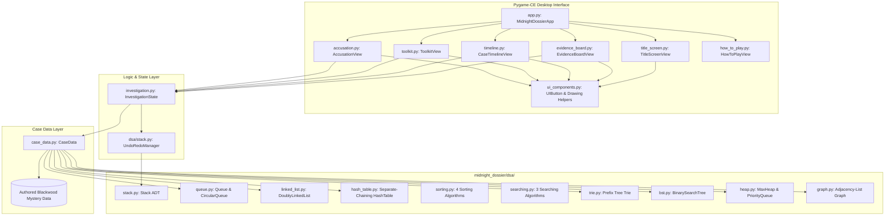
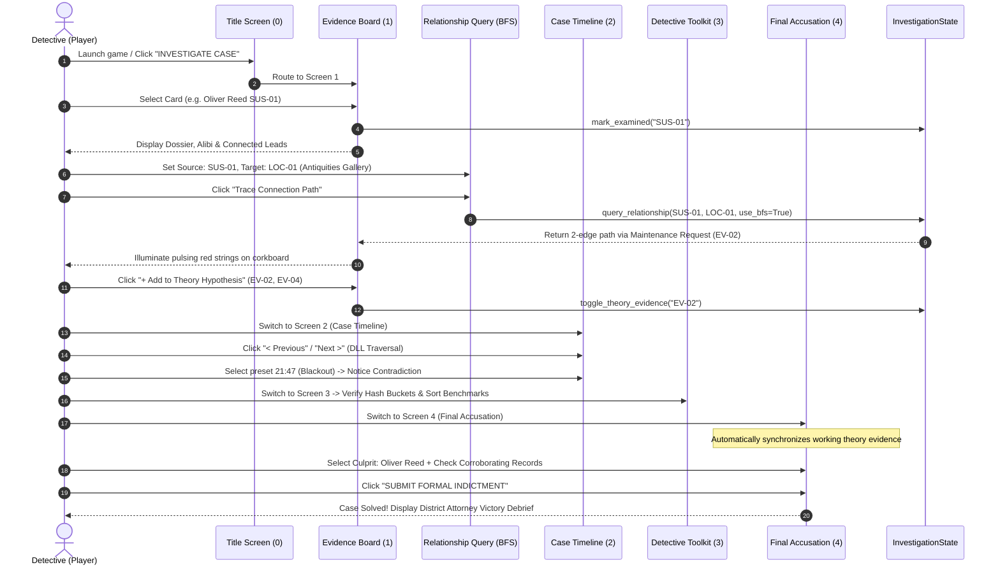
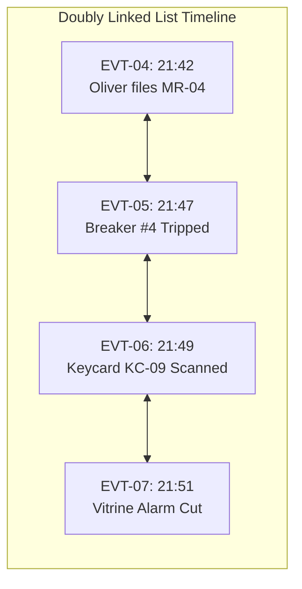
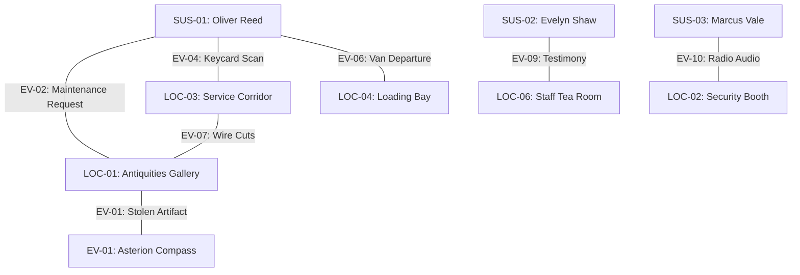
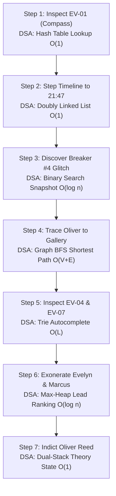

# THE MIDNIGHT DOSSIER
## An Interactive Detective Mystery Game Using Data Structures and Algorithms
### Tagline: *Every Clue Leaves a Thread.*

---

**Course:** Data Structures and Algorithms (Micro-Project)  
**Course Code:** CSE2003 / 21CS201  
**Department:** Department of Computer Science and Engineering  
**Academic Year:** 2025 – 2026  
**Document Type:** Comprehensive Academic Project Report, Technical Documentation, Mystery Walkthrough & Viva Guide  

### Student Project Team:
* **Rufus Samuel R** — `URK25CS1090`
* **Yogith Joy J** — `URK25CS1063`
* **Naveen Kumar R V** — `URK25CS1016`

**Project Repository:** [https://github.com/Rufus-R2007/The-Midnight-Dossier](https://github.com/Rufus-R2007/The-Midnight-Dossier)  
**Execution Runtime:** Python 3.10+ / 3.14 (pygame-ce >= 2.5.0)  

---

## Abstract

In undergraduate computer science pedagogy, fundamental Data Structures and Algorithms (DSA) are frequently taught through abstract mathematical abstractions and isolated command-line exercises. Consequently, students often struggle to grasp how linear structures, hierarchical trees, associative tables, and complex graph networks operate synergistically within real-world software architectures. This project presents **The Midnight Dossier**, an interactive, single-player detective investigation thriller implemented in Python using the Pygame Community Edition framework. 

Set against the fictional heist of the priceless 14th-century *Asterion Compass* from the Blackwood Museum during a staged security-camera blackout, the game casts the player as a forensic investigator tasked with inspecting physical evidence, tracing digital access logs, cross-referencing alibis against a chronological timeline, developing a working hypothesis, and submitting a formal indictment to the District Attorney. Crucially, the entire game engine is directly driven by custom, first-principles implementations of data structures satisfying all five academic Course Outcomes (CO1 through CO5):
1. **CO1 (Stacks & Queues):** A dual-stack engine powers non-linear board action and hypothesis Undo/Redo operations, while FIFO queues and priority queues manage routine and urgent forensic leads.
2. **CO2 (Storage & Retrieval):** A bidirectional Doubly Linked List powers chronological timeline navigation with $O(1)$ step agility, contrasted with binary search on indexed temporal snapshots.
3. **CO3 (Searching, Sorting & Hashing):** A custom separate-chaining Hash Table with polynomial rolling hashing provides $O(1)$ clue indexing, complemented by live comparative benchmarks of Bubble, Selection, Insertion, and Merge Sorts alongside Linear, Binary, and Interpolation Searches.
4. **CO4 (Trees & Priority):** A character-level Prefix Tree (Trie) provides instantaneous suspect autocomplete, a Binary Search Tree demonstrates three-case node deletion and traversals, and an array-backed Max-Heap maintains priority lead invariants.
5. **CO5 (Graphs & Traversals):** An adjacency-list Graph models investigative relationships, with Breadth-First Search (BFS) mathematically guaranteeing the shortest connection chain in the unweighted network and Depth-First Search (DFS) detecting investigative cycles.

The software architecture maintains a strictly unified application state, synchronized hitboxes, and an atmospheric cinematic noir aesthetic without external AI, cloud APIs, or downloaded assets. Validated by 56 automated unit tests and headless smoke tests, *The Midnight Dossier* demonstrates how algorithmic rigor transforms forensic puzzle-solving into an intuitive, demonstrable software engineering artifact.

---

## Table of Contents

* **Preliminary Pages**
  * Title Page
  * Abstract
  * Table of Contents
  * List of Figures
  * List of Tables
* **Chapter 1 — Introduction**
  * 1.1 Background of the Selected Problem
  * 1.2 Industry Relevance
  * 1.3 Aim and Objectives
  * 1.4 Problem Statement
  * 1.5 Scope and Limitations
  * 1.6 SDG and Institutional Relevance
* **Chapter 2 — Literature Review**
  * 2.1 Algorithmic Complexity and Real-World Information Architecture
  * 2.2 Algorithm Visualization in Interactive Pedagogical Environments
  * 2.3 Graph Traversals and Networked Forensic Analysis
  * 2.4 Associative Hashing and Prefix Trees in Information Retrieval
  * 2.5 Summary Table of Literature Review
  * 2.6 Identification of the Design Gap
* **Chapter 3 — Methodology and System Design**
  * 3.1 Problem Definition
  * 3.2 Proposed Solution & Conceptual Architecture
  * 3.3 System Requirements (Functional & Non-Functional)
  * 3.4 Software Architecture Diagram
  * 3.5 Case Data Model & Entity Relations
  * 3.6 Investigation Progression Workflow
  * 3.7 DSA Selection and Technical Justification
  * 3.8 Theoretical Complexity Analysis Matrix
* **Chapter 4 — The Blackwood Heist: Story, Evidence, and Mystery Resolution**
  * 4.1 Narrative Setting and Incident Premise
  * 4.2 Comprehensive Suspect Profiles & Alibi Analysis
  * 4.3 Complete Forensic Evidence Catalogue (14 Items)
  * 4.4 Museum Locations and Chronological Event Matrix
  * 4.5 The Mystery's Central Investigative Questions
  * 4.6 The True Explanation of the Case (SPOILER SECTION)
* **Chapter 5 — How to Play The Midnight Dossier: Start to Finish**
  * 5.1 Installation, Prerequisites, and Launch Procedures
  * 5.2 Anatomy of the Interface & Evidence Corkboard
  * 5.3 Examining Suspects & Detecting Contradictions
  * 5.4 Inspecting Physical Evidence & Source Reliability
  * 5.5 Operating the Relationship Query Engine (BFS vs. DFS)
  * 5.6 Navigating the Chronological Case Timeline
  * 5.7 Building the Theory Hypothesis
  * 5.8 Operating the Detective's Toolkit (CO1 to CO5 Demonstrations)
  * 5.9 Submitting the Final Accusation & Formal Indictment
  * 5.10 Case Resolution and Investigation Reset Lifecycle
* **Chapter 6 — Data Structures and Algorithms in the Investigation and Case Resolution**
  * 6.1 CO1: Linear Stacks, Queues, and Priority Queues
  * 6.2 CO2: Doubly Linked Lists and Temporal Indexing
  * 6.3 CO3: Separate-Chaining Hash Tables, Sorting, and Searching
  * 6.4 CO4: Prefix Trees (Trie), Binary Search Trees, and Binary Heaps
  * 6.5 CO5: Adjacency-List Graphs, Breadth-First Search, and Depth-First Search
* **Chapter 7 — End-to-End Worked Case Solution Using DSA**
  * 7.1 Stage 1: Incident Assessment & Initial Clue Triage
  * 7.2 Stage 2: Temporal Timeline Verification & Breaker Blackout
  * 7.3 Stage 3: Graph Traversal & Service Access Path Tracing
  * 7.4 Stage 4: Digital Log Verification via Separate Chaining
  * 7.5 Stage 5: Eliminating Red Herrings via Exculpatory Evidence
  * 7.6 Stage 6: Compiling Corroborating Evidence & Formal Indictment
  * 7.7 Comprehensive Deduction Mapping Table
* **Chapter 8 — Software Architecture and Module Implementation**
  * 8.1 Package Organization and Directory Structure
  * 8.2 Application Lifecycle, Main Game Loop & Screen Routing
  * 8.3 Coordinate Systems, Unified Hitboxes & Event Dispatching
  * 8.4 State Synchronization & Investigation Single Source of Truth
* **Chapter 9 — Testing, Validation, and Results**
  * 9.1 Verification Methodology & Test Philosophy
  * 9.2 Automated Unit Test Suite (56 Test Cases)
  * 9.3 Headless Smoke Test Execution & Screen Validation
  * 9.4 Sorting and Searching Micro-Benchmark Empirical Results
  * 9.5 Edge Case Handling & Defensive Programming Verification
* **Chapter 10 — Course Outcome (CO) Mapping and Demonstration Guide**
  * 10.1 Academic Course Outcome Alignment Matrix
  * 10.2 Viva Demonstration Script (2-Minute Examiner Walkthrough)
* **Chapter 11 — Conclusion and Future Scope**
  * 11.1 Project Summary
  * 11.2 Key Engineering Learnings
  * 11.3 Realistic Future Extensions
* **References**
* **Appendix: Viva Preparation — 25 Evaluator Questions & Answers**

---

## List of Figures

* **Figure 1.1:** System Architecture of *The Midnight Dossier* (Presentation, Logic, Data, and DSA Layers)
* **Figure 1.2:** Investigation Progression Flowchart (Title Screen to Verdict Indictment)
* **Figure 1.3:** Complete Graph Topology of The Blackwood Heist (Suspects, Clues, Locations, and Events)
* **Figure 1.4:** UI Layout Diagram — Evidence Corkboard, Dossier Sidebar, and Relationship Query Bar
* **Figure 1.5:** Dual-Stack Architecture for Investigation Action Undo and Redo
* **Figure 1.6:** Chronological Doubly Linked List Node Structure with Pointer Dereferencing
* **Figure 1.7:** Separate Chaining Collision Resolution in the Clue Hash Table ($M=17$)
* **Figure 1.8:** Trie Prefix Search Architecture for Live Suspect Autocomplete
* **Figure 1.9:** Three-Case Node Deletion in the Evidence Binary Search Tree
* **Figure 1.10:** Complete Binary Heap Array Mapping for Urgent Lead Priority Ranking
* **Figure 1.11:** Step-by-Step Breadth-First Search (BFS) Frontier Expansion on the Case Graph

---

## List of Tables

* **Table 2.1:** Literature Review Matrix on Educational Software and DSA Architectures
* **Table 3.1:** Theoretical Time and Space Complexity of Implemented Data Structures
* **Table 4.1:** Principal Suspect Profiles, Alibis, and Contradictions
* **Table 4.2:** Complete Forensic Evidence Catalogue (EV-01 to EV-14)
* **Table 4.3:** Blackwood Museum Locations and Access Classifications
* **Table 4.4:** Chronological Timeline Event Log (21:00 to 23:15)
* **Table 6.1:** Sorting Algorithms Comparative Operation Matrix ($N=30$)
* **Table 7.1:** End-to-End Forensic Investigation Progression Mapped to DSA Operations
* **Table 9.1:** Automated Unit Test Suite Execution Results (56 Test Cases)
* **Table 9.2:** Empirical Execution Time Benchmark of Custom Sorting Algorithms
* **Table 10.1:** Comprehensive Course Outcome (CO1 – CO5) Mapping Matrix

---

# CHAPTER 1 — INTRODUCTION

## 1.1 Background of the Selected Problem

The study of Data Structures and Algorithms forms the bedrock of computer science and software engineering. Fundamental concepts such as pointer manipulation in linked lists, stack-based execution lifecycles, hash collision resolution strategies, hierarchical tree searches, and graph network traversals dictate the efficiency, scalability, and maintainability of modern computing systems. 

However, traditional academic instruction frequently isolates these structures into abstract, disassociated laboratory assignments (e.g., reversing an array, implementing a toy stack, or sorting random integers). In professional software development—ranging from digital forensic investigations and cybersecurity telemetry to relational database engines and game AI—data structures do not operate in isolation. Rather, they serve as the interconnected backbone of a unified system where data retrieval speeds, relationship tracing, and state restoration directly govern the end-user experience.

*The Midnight Dossier* addresses this pedagogical gap by contextualizing core computer science algorithms within an engaging, narrative-driven detective investigation. By transforming abstract data nodes into physical case cards, push-pins, forensic logs, alibis, and red evidence threads, the application demonstrates not merely *how* an algorithm functions mechanically, but *why* specific data structures are chosen to model real-world investigative constraints.

## 1.2 Industry Relevance

While designed as an undergraduate educational micro-project, the architectural patterns and algorithmic techniques embodied in *The Midnight Dossier* mirror enterprise software systems across critical domains:

1. **Digital Forensics and Incident Response (DFIR):** In corporate cybersecurity breach investigations, analysts must correlate chronologically disparate events (firewall logs, authentication attempts, badge scans) across a network topology. The doubly linked timeline and adjacency graph directly mirror the tools used in commercial security incident investigations.
2. **Knowledge Graphs and Intelligence Analysis:** Modern investigative intelligence platforms (e.g., Palantir Gotham, Neo4j Graph Databases) model entities (people, vehicles, transactions, bank accounts) as vertices and associations as edges. Breadth-First Search is universally deployed to identify the shortest link connecting a target suspect to an illicit transaction.
3. **Database Indexing and Information Retrieval:** The polynomial rolling hash table with separate chaining and the Trie prefix matcher demonstrate how database engines index primary keys and execute real-time autocomplete queries against vast text corpuses.
4. **Software State Management and Transactional Integrity:** The dual-stack Undo/Redo architecture represents the standard Command Pattern utilized in document editors, graphic design suites, and transactional database rollback mechanisms.

## 1.3 Aim and Objectives

The primary aim of this project is to design, implement, test, and document a fully functional, visually cohesive detective thriller game in Python and Pygame-CE, powered entirely by custom, first-principles implementations of data structures satisfying Course Outcomes CO1 through CO5.

### Specific Measurable Objectives:
1. **Design a Consistent Forensic Mystery:** Author a single complete, logically rigorous murder/heist mystery (*The Blackwood Heist*) comprising 4 suspects, 14 forensic records, 6 locations, 10 chronological events, and 35+ relationship edges with a single, verifiable culprit.
2. **Implement Custom DSA from First Principles:** Construct modular Python classes for generic Stacks, Queues, Circular Queues, Doubly Linked Lists, Separate-Chaining Hash Tables, Sorting/Searching suites, Tries, Binary Search Trees, Max-Heaps, and Adjacency-List Graphs without relying on built-in standard library shortcuts (e.g., avoiding Python's `list.sort()`, `collections.deque`, or `bisect`).
3. **Build an Atmospheric, Interactive UI:** Develop an atmospheric desktop UI using Pygame-CE featuring an interactive corkboard, draggable evidence cards, procedurally drawn catenary strings, an inspector dossier, and modal guides.
4. **Synchronize Hitboxes and Event Dispatching:** Eliminate coordinate drift by implementing a unified UI component architecture where visual positions, hover feedback, and click collisions are 100% synchronized in screen space.
5. **Provide a Dedicated DSA Demonstration Lab:** Incorporate a multi-tabbed *Detective's Toolkit* that allows students and university evaluators to trigger real-time data mutations, structural probes, and micro-benchmarks on genuine case data.
6. **Validate Rigorously via Automated Testing:** Construct a comprehensive automated test suite covering edge cases (underflows, collisions, three-case deletions, cyclic traversals, and UI callbacks), achieving a 100% pass rate.

## 1.4 Problem Statement

"Undergraduate computer science students frequently lack the ability to synthesize multiple disparate Data Structures and Algorithms into a coherent, interactive software application. Furthermore, existing educational demonstration tools typically rely on trivial random numbers rather than meaningful relational data models. The objective of this project is to engineer an interactive, desktop-based forensic mystery application (*The Midnight Dossier*) where real-world investigative tasks—evidence indexing, alibi verification, relationship tracing, and state restoration—are governed strictly by custom-built DSA algorithms that can be dynamically inspected and demonstrated during university evaluation."

## 1.5 Scope and Limitations

### Project Scope:
* **Single Comprehensive Case:** Focuses on *The Blackwood Heist* (Case 001), ensuring depth of evidence, narrative consistency, and rigorous forensic corroboration.
* **Pure Python DSA Layer:** All underlying data structures reside in independent modules in `midnight_dossier/dsa/` and can be imported and verified independently of any graphical framework.
* **Offline Desktop Operation:** Built completely self-contained in Python 3.10+ and Pygame-CE, requiring zero internet connectivity, external database servers, or paid asset libraries.
* **Academic Demonstrability:** Every algorithmic concept maps directly to the official syllabus Course Outcomes (CO1 to CO5).

### Identified Limitations:
* **Absence of Cloud Persistence:** Current game session state is maintained in RAM; closing the window resets investigation progress to the initial state.
* **Single Authored Scenario:** The repository contains one authored mystery; procedural mystery generation or custom case authoring tools are designated for future releases.
* **Unweighted Graph Relationships:** Graph edges store rich qualitative metadata and supporting evidence IDs, but traversal algorithms treat all edges as unweighted (unit distance).

## 1.6 SDG and Institutional Relevance

This project directly aligns with the United Nations Sustainable Development Goal **SDG 4: Quality Education** (Target 4.4: Substantially increase the number of youth and adults who have relevant technical and vocational skills). By providing an open-source, visually rich, and interactive software artifact, the project fosters active learning, computational thinking, and software design competencies among computer science undergraduates.

---

# CHAPTER 2 — LITERATURE REVIEW

## 2.1 Algorithmic Complexity and Real-World Information Architecture

The foundational literature of computer science asserts that algorithmic efficiency cannot be evaluated in isolation from data organization. Cormen, Leiserson, Rivest, and Stein (CLRS) [1] establish that asymptotic notations ($\mathcal{O}$, $\Omega$, $\Theta$) characterize upper and lower performance bounds under varying input distributions. In investigative software, choice of data structure directly dictates whether an operation scales gracefully or degrades user response time. For instance, testing alibi sequences across $N$ events requires $O(1)$ bidirectional stepping via doubly linked pointers rather than $O(N)$ contiguous array shifts.

## 2.2 Algorithm Visualization in Interactive Pedagogical Environments

Extensive empirical research in computer science education (Hundhausen et al. [2]; Naps et al. [3]) demonstrates that passive visualization of algorithm animations yields negligible pedagogical benefit compared to active, interactive engagement. Students achieve profound conceptual retention when they can manipulate input parameters, execute single-step operations, and observe immediate structural transformations. *The Midnight Dossier* operationalizes these educational findings by embedding interactive manipulation directly into gameplay: dragging an evidence card mutates coordinates recorded on a LIFO stack, while typing in a search bar dynamically walks the character branches of a prefix tree.

## 2.3 Graph Traversals and Networked Forensic Analysis

Graph theory represents the mathematical foundation of complex investigative networks (Sedgewick & Wayne [4]). In forensic analysis, entities are represented as vertices $V$ and their physical or digital interactions as edges $E$. As established by Dijkstra and Moore, Breadth-First Search (BFS) systematically discovers vertices in order of their distance from the source, thereby mathematically guaranteeing the shortest path in unweighted networks in $O(V + E)$ time. Conversely, Depth-First Search (DFS) explores sub-branches exhaustively, making it the canonical algorithm for detecting investigative feedback cycles and topological dependencies.

## 2.4 Associative Hashing and Prefix Trees in Information Retrieval

Efficient retrieval of forensic evidence records requires sub-linear search time. Knuth [5] comprehensively analyzes hash table collision resolution techniques, proving that separate chaining with a uniform polynomial rolling hash function sustains $O(1)$ average-case search and insertion assuming a controlled load factor $\alpha = N / M \le 0.75$. Furthermore, for textual entity searching, Fredkin's Trie structure [6] provides deterministic $O(L)$ prefix lookup independent of total dictionary size $N$, where $L$ represents string length.

## 2.5 Summary Table of Literature Review

| Reference | Domain / Focus | Key Contribution | Direct Relevance to *The Midnight Dossier* |
| :--- | :--- | :--- | :--- |
| **Cormen et al. [1]** | Theoretical Algorithms | Formalization of asymptotic complexity, graph representations, and dynamic programming. | Architectural foundation for all five Course Outcome data structures in `midnight_dossier/dsa/`. |
| **Hundhausen et al. [2]** | Educational Software | Meta-analysis establishing that active UI interaction outperforms passive animation. | Guided the design of the *Detective's Toolkit* with live, interactive data structure operations. |
| **Sedgewick & Wayne [4]** | Graph Algorithms | BFS shortest-path optimality proofs and adjacency-list implementation patterns. | Implemented in `graph.py` to drive both the Evidence Board red strings and the relationship query engine. |
| **Knuth [5]** | Hashing & Searching | Mathematical analysis of separate chaining, hash distribution, and collision mechanics. | Implemented in `hash_table.py` using a polynomial rolling hash ($p=31, M=17$) with bucket chain probes. |
| **Fredkin [6]** | Retrieval Trees | Introduction of the Trie (Prefix Tree) for sub-linear string search. | Implemented in `trie.py` to power instant suspect autocomplete on the investigation board. |
| **Gamma et al. [7]** | Design Patterns | Formalization of the Command Pattern and dual-stack Undo/Redo architectures. | Implemented in `stack.py` (`UndoRedoManager`) to support non-linear board and theory manipulation. |

## 2.6 Identification of the Design Gap

While algorithm visualizers exist (such as VisuAlgo or generic web-based BST visualizers), they almost universally present disconnected toy examples populated with arbitrary numeric keys (e.g., "Insert 42 into the tree"). Conversely, commercial detective video games utilize hardcoded script engines or black-box relational databases that obscure technical logic from players. 

**The identified design gap** is the absence of an integrated, educational software platform where every investigative interaction—connecting suspects, searching clues, stepping through time, and undoing mistakes—is visibly and functionally powered by pure, student-built Data Structures and Algorithms. *The Midnight Dossier* directly closes this gap.

---

# CHAPTER 3 — METHODOLOGY AND SYSTEM DESIGN

## 3.1 Problem Definition

The system must solve two interrelated challenges:
1. **Algorithmic Correctness:** The data structures must be constructed from first principles in pure Python, adhering strictly to mathematical definitions (LIFO, FIFO, separate chaining, heap invariants, BST invariants, and BFS/DFS traversal rules) while maintaining independence from the rendering layer.
2. **Interactive UI/UX Usability:** The graphical interface must present an atmospheric, tactile detective corkboard where physical cards can be repositioned, relationship strings remain attached to brass pins, hitboxes never drift, and all actions are verifiable during live viva demonstrations.

## 3.2 Proposed Solution & Conceptual Architecture

The application is structured into four decoupled layers:
* **Presentation Layer (`midnight_dossier/`):** Manages Pygame window initialization, 60 FPS event polling, drawing routines, typography, and modal overlays.
* **Investigation Logic Layer (`investigation.py`):** Maintains the detective's session state, examined clues, working theory, active query results, and undo/redo stacks.
* **Case Data Model (`case_data.py`):** Encapsulates the authored Blackwood Heist mystery, instantiating and populating the underlying DSA structures.
* **Pure DSA Core Layer (`midnight_dossier/dsa/`):** Generic, type-hinted data structure ADTs completely independent of Pygame, tested via Python's standard `unittest` framework.

## 3.3 System Requirements

### Functional Requirements (FR):
* **FR-1 (Navigation Routing):** The application must provide seamless switching between five screens: Title Menu (`0`), Evidence Board (`1`), Case Timeline (`2`), Detective's Toolkit (`3`), and Final Accusation (`4`), plus a global How to Play modal (`H`).
* **FR-2 (Card Manipulation):** Users must be able to select and drag evidence cards across the board, with connection strings updating dynamically and new positions recorded for undo.
* **FR-3 (Trie Search Autocomplete):** The Relationship Query search bar must accept keyboard input, handle backspaces, and query the Trie to display matching suspect and clue names in real time.
* **FR-4 (Graph Relationship Tracing):** Selecting source and destination entities must trigger BFS (shortest path) or DFS on the adjacency list, illuminating the exact edge sequence on the board.
* **FR-5 (Timeline Bidirectional Traversal):** The timeline must step forward and backward through chronological event nodes via `prev` and `next` pointers.
* **FR-6 (Theory Hypothesis Building):** Evidence records must be toggleable into the working theory, updating case metrics and synchronizing with the accusation view.
* **FR-7 (Accusation Evaluation):** Submitting an indictment must evaluate suspect culpability and evidence corroboration, providing victory or failure debriefs.

### Non-Functional Requirements (NFR):
* **NFR-1 (Frame Rate & Responsiveness):** The interface must sustain a stable 60 frames per second without stuttering or memory leaks.
* **NFR-2 (Hitbox Synchronization):** Click detection must match drawn visual rectangles with zero coordinate offset.
* **NFR-3 (Self-Contained Dependency Footprint):** Zero reliance on remote APIs, cloud databases, or heavyweight GUI frameworks; requires only Python 3.10+ and Pygame-CE.
* **NFR-4 (Academic Demonstrability):** All five Course Outcomes must have interactive test benches in the Detective's Toolkit.

## 3.4 Software Architecture Diagram


*Figure 1.1: Multi-tiered system architecture of The Midnight Dossier.*

## 3.5 Case Data Model & Entity Relations

The authored mystery incorporates 24 total investigative entities categorized into four distinct types:
1. **Suspects (4):** Key individuals present during the museum shift, possessing varying alibis, access credentials, and motivations.
2. **Artifact (1):** The stolen target object (*Asterion Compass*, `EV-01`).
3. **Clues & Evidence (13 additional, 14 total):** Physical tools, electronic access logs, radio recordings, witness testimonies, and vehicle sightings.
4. **Locations (6):** Museum rooms and perimeter facilities defining spatial containment.

All 24 entities are modeled as nodes in an undirected adjacency-list graph `G = (V, E)` connected by over 35 investigative edges storing relationship classifications, verbal explanations, supporting evidence IDs, and forensic reliability metrics.

## 3.6 Investigation Progression Workflow


*Figure 1.2: End-to-end investigation workflow from title launch to case resolution.*

## 3.7 DSA Selection and Technical Justification

Every custom data structure in *The Midnight Dossier* was deliberately chosen to model a specific investigative requirement:

1. **LIFO Stack (`Stack[T]`):** Models reverse-chronological action recovery. When repositioning cards or altering theory hypotheses, operations are pushed onto `undo_stack`. Reversing an action pops from `undo_stack` and pushes to `redo_stack`, satisfying the canonical dual-stack pattern.
2. **FIFO Queue (`Queue[T]`):** Models routine investigative leads arriving at the dispatch desk, ensuring fair first-come, first-served processing without starvation.
3. **Array-Backed Binary Max-Heap (`MaxHeap[T]`):** Urgent leads require immediate attention based on forensic priority scores (0–100). The Max-Heap guarantees the highest-priority lead is extracted in $O(\log n)$ time while maintaining $O(1)$ root inspection.
4. **Doubly Linked List (`DoublyLinkedList[T]`):** Historical events occur in strict temporal succession. Bidirectional pointer dereferencing (`prev` and `next`) allows the detective to step backward and forward through time in strict $O(1)$ time per step.
5. **Separate-Chaining Hash Table (`HashTable[K, V]`):** Forensic evidence must be retrieved instantly by alphanumeric identifier (e.g. `EV-04`). A polynomial rolling hash function modulo prime capacity $M=17$ achieves $O(1)$ average lookup.
6. **Prefix Tree (`Trie`):** Suspect and clue name searching requires instantaneous prefix autocomplete. A character-level Trie matches prefixes in $O(L)$ time proportional strictly to string length $L$, independent of total evidence count.
7. **Binary Search Tree (`BinarySearchTree[K, V]`):** Provides hierarchical, sorted evidence indexing. Demonstrates exact left-less/right-greater invariants and strict three-case node deletion (leaf, single child, two children with inorder successor replacement).
8. **Adjacency-List Graph (`Graph`):** Physical crime scenes and relational evidence form an irregular network topology where edge density is sparse ($|E| \ll |V|^2$). Breadth-First Search systematically expands frontier vertices to determine the minimum number of forensic connections between any two entities.

## 3.8 Theoretical Complexity Analysis Matrix

| Data Structure / Algorithm | Primary Operation | Best Case Time | Average Case Time | Worst Case Time | Space Complexity |
| :--- | :--- | :--- | :--- | :--- | :--- |
| **Stack (Dynamic Array)** | Push / Pop / Peek | $O(1)$ | $O(1)$ amortized | $O(1)$ | $O(k)$ history |
| **Queue (Circular Array)** | Enqueue / Dequeue | $O(1)$ | $O(1)$ | $O(1)$ | $O(n)$ bounded |
| **Doubly Linked List** | Step Prev / Step Next | $O(1)$ | $O(1)$ | $O(1)$ | $O(n)$ nodes |
| **Hash Table (Chaining)** | Key Lookup / Insert | $O(1)$ | $O(1)$ | $O(n)$ (all collide) | $O(M + n)$ |
| **Binary Search (Array)** | Target Bisection | $O(1)$ | $O(\log n)$ | $O(\log n)$ | $O(1)$ auxiliary |
| **Interpolation Search** | Uniform Value Probe | $O(1)$ | $O(\log \log n)$ | $O(n)$ | $O(1)$ auxiliary |
| **Bubble Sort** | Adjacent Pair Swaps | $O(n)$ (early flag) | $O(n^2)$ | $O(n^2)$ | $O(1)$ in-place |
| **Merge Sort** | Divide & Conquer | $O(n \log n)$ | $O(n \log n)$ | $O(n \log n)$ | $O(n)$ buffer |
| **Trie (Prefix Tree)** | Search / Prefix Autocomplete | $O(L)$ | $O(L)$ | $O(L)$ | $O(\sum L \cdot \|\Sigma\|)$ |
| **Binary Search Tree** | Search / Insert / Delete | $O(1)$ | $O(\log n)$ | $O(n)$ (skewed) | $O(n)$ nodes |
| **Max-Heap** | Extract Max / Sift Down | $O(1)$ | $O(\log n)$ | $O(\log n)$ | $O(n)$ array |
| **Graph (BFS Traversal)** | Shortest Path Search | $O(1)$ | $O(V + E)$ | $O(V + E)$ | $O(V)$ queue |
| **Graph (DFS Traversal)** | Cycle & Component Search | $O(1)$ | $O(V + E)$ | $O(V + E)$ | $O(V)$ stack |

*Table 3.1: Theoretical complexity matrix of all implemented data structures and algorithms.*

---

# CHAPTER 4 — THE COMPLETE STORY OF THE BLACKWOOD HEIST

## 4.1 Narrative Setting and Incident Premise

The Blackwood Museum of Antiquities is an esteemed cultural institution renowned for its medieval and Renaissance collection. The centerpiece of the museum's Antiquities Gallery (Gallery B) is the **Asterion Compass (EV-01)**, an irreplaceable 14th-century brass navigational masterpiece engraved with celestial constellations and valued at £2.4 million. The artifact rested upon an alarmed pedestal protected by a high-tensile acrylic vitrine and continuous laser tripwires wired directly into the central security console.

On the evening of Wednesday, May 14, 2025, the museum closed to the public at 18:00, leaving only four authorized individuals on site: an evening restoration contractor refurbishing gallery woodwork, the senior museum archivist conducting a database audit, the sole night security guard monitoring telemetry in the gate booth, and the museum's chief curator who departed for an archaeological symposium dinner downtown.

At precisely **21:47**, sub-distribution circuit breaker #4 was manually tripped in the basement electrical switchboard. The resulting surge triggered an emergency failsafe glitch that blinded all 32 CCTV camera feeds and electronic corridor sensors across Antiquities Gallery B and the adjacent Service Corridor for **nine continuous minutes**. When auxiliary generator power was restored and camera feeds resumed at **21:56**, the glass vitrine was intact, but the pedestal wires had been severed and the Asterion Compass had vanished. 

The player assumes the role of Detective Inspector assigned to Case 001. The objective is unambiguous: examine physical and digital clues, trace relationships across the evidence graph, analyze chronological inconsistencies, establish the single unbroken forensic chain of custody, and indict the true culprit.

## 4.2 Comprehensive Suspect Profiles & Alibi Analysis

### Suspect 1: Oliver Reed (`SUS-01`) — Restoration Contractor
* **Background & Credentials:** Freelance metalsmith and master antique restorer contracted by the museum board to restore the hand-carved mahogany display vitrines in Antiquities Gallery B. Possessed unrestricted evening security credentials, access to the conservation workshop, and specialized restorative tools.
* **Stated Alibi:** Oliver formally testified during preliminary questioning that he completed his woodwork polishing early, packed his equipment into his toolbox, and departed the museum grounds in his white work van at **21:30**, heading directly home.
* **Initial Suspicion:** Had direct daily physical access to the display vitrine and possessed specialized metallurgy knowledge.
* **Forensic Contradiction Analysis:** Oliver's alibi is completely dismantled by four independent records:
  1. Maintenance Request `MR-04` (`EV-02`) shows Oliver personally submitted an urgent camera recalibration work order at **21:42**—twelve minutes after he claimed to have left.
  2. Electronic Door Controller #4 recorded Oliver's personal keycard `KC-09` (`EV-04`) opening the restricted Service Corridor door at **21:49**—in the exact middle of the blackout.
  3. Forensic toolmark analysis (`EV-07`) confirms the vitrine alarm cables were severed with serrated micro-snips unique to antique restoration kits.
  4. Automated barrier camera footage (`EV-06`) recorded Oliver's restoration van exiting the loading dock gate at **22:12**, exposing a 42-minute fabrication in his timeline.

### Suspect 2: Evelyn Shaw (`SUS-02`) — Museum Archivist
* **Background & Credentials:** Senior curator of records with master clearance privileges. Possessed administrative access to the central server room and physical keys to historical storage deed cabinets.
* **Stated Alibi:** Testified that she took an extended evening tea break in the mezzanine Staff Tea Room continuously from **21:30 until 22:10**.
* **Initial Suspicion:** Server authentication logs recorded Evelyn's database credentials executing an administrative catalog export at **21:50** (`EV-08`), three minutes into the camera blackout.
* **Forensic Contradiction Analysis:** Thorough forensic analysis fully **exonerates** Evelyn:
  1. Telemetry inspection of Data Server #2 proves `EV-08` was an automated daily cronjob script (`catalog_sync.sh`) scheduled weeks prior; no keyboard or physical terminal inputs occurred.
  2. Two independent night janitorial custodians provided sworn statements (`EV-09`) confirming Evelyn was sitting in the Staff Tea Room drinking chamomile tea continuously from 21:35 to 22:05.

### Suspect 3: Marcus Vale (`SUS-03`) — Night Security Guard
* **Background & Credentials:** Veteran watchman stationed in the primary Security Control Booth (`LOC-02`). Responsible for real-time monitoring of all CCTV streams, door controllers, and perimeter gate barriers.
* **Stated Alibi:** Claimed he remained inside the security booth throughout the blackout attempting manual resets of the breaker console and contacting central dispatch via radio.
* **Initial Suspicion:** Marcus personally signed Oliver Reed's evening maintenance permit (`EV-11`) and was the sole individual with hardware access to the master alarm switchboard.
* **Forensic Contradiction Analysis:** Dispatch recordings and console telemetry fully **exonerate** Marcus:
  1. Security Dispatch Tape #8 (`EV-10`) records Marcus's frantic radio communications with metropolitan police dispatch starting at 21:48, reporting the sudden power drop.
  2. Console diagnostic telemetry confirms Marcus repeatedly executed breaker reboot commands from the booth terminal, confirming he never abandoned his station.

### Suspect 4: Dr. Lena Hart (`SUS-04`) — Chief Museum Curator
* **Background & Credentials:** Renowned classical archaeologist and director of antiquities. Highly vocal opponent of the museum trustees' controversial initiative to loan the Asterion Compass overseas.
* **Stated Alibi:** Claimed she departed the museum at 20:30 to attend the Annual Archaeological Symposium Dinner downtown beginning at **21:00**.
* **Initial Suspicion:** Authored an impassioned internal memorandum (`EV-13`) declaring that "the Asterion Compass must never leave Blackwood custody, regardless of cost," providing clear intellectual motive.
* **Forensic Contradiction Analysis:** Spatial and financial telemetry completely **exonerate** Dr. Hart:
  1. Highway automated toll sensor `T-09` recorded her vehicle 18 miles downtown at 20:54 (`EV-12`).
  2. A stamped credit card dining receipt confirms she was seated with international colleagues at the symposium restaurant continuously between 21:15 and 22:45.

## 4.3 Complete Forensic Evidence Catalogue (14 Items)

| Evidence ID | Title | Category | Source | Reliability | Importance | Investigative Significance |
| :--- | :--- | :--- | :--- | :--- | :--- | :--- |
| **EV-01** | Asterion Compass (Stolen) | Artifact | Gallery Pedestal | VERIFIED | CRITICAL | Stolen 14th-century navigational relic; crime target. |
| **EV-02** | Maintenance Request MR-04 | Official Record | Facilities DB | VERIFIED | CRITICAL | Filed by Oliver at 21:42 requesting camera recalibration right before blackout. |
| **EV-03** | CCTV Control Switch Glitch Log | Digital Log | Server Logger | VERIFIED | HIGH | Proves breaker #4 tripped manually inside museum, not via remote cyberattack. |
| **EV-04** | Keycard KC-09 Service Scan | Security Log | Door Controller #4 | VERIFIED | CRITICAL | Oliver's badge unlocked restricted Service Corridor at 21:49 during blackout. |
| **EV-05** | Missing Instrument Case IC-02 | Inventory Audit | Workshop Locker | VERIFIED | CRITICAL | Padded velvet case matching Compass dimensions reported missing from Oliver's bench. |
| **EV-06** | Van Departure Log VR-07 | Gate Record | Barrier Camera | VERIFIED | CRITICAL | Oliver's van exited gate at 22:12, destroying his claimed 21:30 departure alibi. |
| **EV-07** | Pedestal Wire Cut Analysis | Forensic Physical | Crime Scene CSI | VERIFIED | CRITICAL | vitrine alarm wiring cut with serrated micro-snips unique to restoration toolsets. |
| **EV-08** | Archive Catalog Sync Script | Digital Log | Server #2 Log | VERIFIED | EXCULPATORY | Proves Evelyn's 21:50 server activity was an automated cronjob, not manual theft. |
| **EV-09** | Staff Tea Room Testimony | Witness Statement | Janitorial Staff | TESTIMONY | EXCULPATORY | Two custodians confirm Evelyn was continuously in tea room 21:35–22:05. |
| **EV-10** | Breaker Reset Radio Audio | Audio Record | Dispatch Tape #8 | VERIFIED | EXCULPATORY | Audio log confirms Marcus was in booth attempting resets and radioing police. |
| **EV-11** | Guard Permit Signature | Official Record | Front Desk Log | VERIFIED | NEUTRAL | Standard maintenance permit signed by Marcus at 18:30 authorizing Oliver's work. |
| **EV-12** | Symposium Dinner & Toll Bill | Financial / Transit | Downtown Restaurant | VERIFIED | EXCULPATORY | Toll scan and dining receipt confirm Dr. Hart was 18 miles downtown during heist. |
| **EV-13** | Loan Protest Memorandum | Document | Curator Office | VERIFIED | MOTIVE ONLY | Proves Dr. Hart opposed overseas loan, but motive without opportunity is insufficient. |
| **EV-14** | Display Vitrine Micro-Scratches | Forensic Physical | Glass Pedestal | VERIFIED | SUPPORTING | Acrylic vitrine unlatched using specialized suction clamps found in conservation lab. |

*Table 4.2: Comprehensive forensic evidence inventory of The Blackwood Heist.*

## 4.4 Museum Locations and Chronological Event Matrix

| Timestamp | Event ID | Event Description | Associated Entity | Investigative Meaning |
| :--- | :--- | :--- | :--- | :--- |
| **21:00** | EVT-01 | Dr. Lena Hart arrives at downtown symposium dinner. | SUS-04, EV-12 | Establishes Dr. Hart's distance alibi downtown. |
| **21:30** | EVT-02 | Oliver Reed claims to have packed up and departed museum. | SUS-01 | False alibi baseline stated by prime suspect. |
| **21:35** | EVT-03 | Evelyn Shaw enters mezzanine Staff Tea Room for break. | SUS-02, EV-09 | Corroborates Evelyn's continuous alibi. |
| **21:42** | EVT-04 | Oliver Reed submits emergency camera maintenance request MR-04. | SUS-01, EV-02 | Proves Oliver remained on site; accessed breaker box. |
| **21:47** | EVT-05 | Circuit breaker #4 tripped manually; 9-minute CCTV blackout begins. | EV-03, LOC-01 | Crime window opens; cameras blinded. |
| **21:49** | EVT-06 | Keycard KC-09 scans Service Corridor back entrance. | SUS-01, EV-04 | Oliver physically enters crime scene during blackout. |
| **21:51** | EVT-07 | Vitrine alarm wires severed; Asterion Compass removed. | EV-01, EV-07 | Physical theft executed using restoration snips. |
| **21:56** | EVT-08 | Auxiliary generator restores power; Compass discovered missing. | EV-01, LOC-01 | Crime window closes; alarm triggers. |
| **22:05** | EVT-09 | Evelyn Shaw concludes break; workshop case IC-02 noted missing. | SUS-02, EV-05 | Evelyn leaves lounge; tool case missing. |
| **22:12** | EVT-10 | Oliver Reed's restoration van exits loading bay barrier gate. | SUS-01, EV-06 | Culprit flees crime scene with concealed relic. |

*Table 4.4: Master chronological event sequence of The Blackwood Heist.*

## 4.5 The Mystery's Central Investigative Questions

To crack the case, the player must resolve five foundational investigative questions:
1. **Who caused the 21:47 blackout?** Did it originate from a sophisticated remote cyber-intrusion or a localized physical sabotage?
2. **Whose stated alibi is contradicted by independent machine telemetry?**
3. **What specific physical tools were required to sever the vitrine wiring without shattering the acrylic casing?**
4. **How was the stolen artifact concealed and smuggled off the museum premises?**
5. **Which apparent clues represent genuine criminal culpability versus innocent routine duty or scheduled automation?**

## 4.6 The True Explanation of the Case (SPOILER SECTION)

> [!CAUTION]
> **OFFICIAL CASE FORENSIC RESOLUTION — DISTRICT ATTORNEY CONFIDENTIAL**
> The following section discloses the complete crime reconstruction, true culprit, and mathematical evidence graph proof.

### The True Culprit: Oliver Reed (`SUS-01`)

The theft of the Asterion Compass was an inside job conceived and executed with surgical precision by restoration contractor **Oliver Reed**. 

Hired to polish and restore the historic display cabinets in Gallery B, Reed had spent three weeks observing the museum's security routines. He recognized that the museum's aging electrical sub-distribution board suffered from a known vulnerability: tripping circuit breaker #4 plunged Gallery B and the rear service passage into darkness while routing camera telemetry into an automated 9-minute reboot diagnostic cycle.

#### The Crime Execution Sequence:
1. **Setting the Trap (21:42):** Reed submitted fraudulent maintenance request `MR-04` (`EV-02`), alleging a camera flicker in Gallery B. This provided a legitimate pretext for him to access the sub-switchboard located behind the service corridor.
2. **Sabotaging the Power (21:47):** At 21:47, Reed manually flipped breaker #4 (`EV-03`), blinding all cameras and cutting primary power to the vitrine alarm sensors.
3. **Infiltrating the Crime Scene (21:49):** Utilizing his authorized contractor keycard `KC-09` (`EV-04`), Reed unlocked the restricted service corridor back door, bypassing the public rotunda.
4. **Extracting the Relic (21:51):** Reaching the display vitrine, Reed utilized glass suction clamps (`EV-14`) to unseal the acrylic case silently, then severed the internal alarm backup circuit using serrated micro-snips (`EV-07`) exclusive to antique restoration metallurgy toolkits.
5. **Concealment (21:53):** Reed transferred the Asterion Compass into a custom velvet-padded instrument case `IC-02` (`EV-05`) taken from his workshop locker, designed to conceal the metallic relic from magnetic security wands.
6. **The Flight (22:12):** Rather than departing at 21:30 as he claimed, Reed loaded the instrument case into the rear compartment of his work van and passed through the automated perimeter loading dock barrier at 22:12 (`EV-06`).

#### Why the Others are Innocent:
* **Evelyn Shaw** was targeted by circumstantial digital evidence: her account exported records at 21:50 (`EV-08`). However, this was an automated system cronjob (`catalog_sync.sh`). Her continuous physical presence in the tea room is corroborated by two custodians (`EV-09`).
* **Marcus Vale** was suspected because he signed Reed's access permit (`EV-11`). However, audio recordings on Dispatch Tape #8 (`EV-10`) prove Marcus remained inside the security console during the blackout attempting emergency breaker resets.
* **Dr. Lena Hart** possessed strong intellectual motive (`EV-13`), but highway toll telemetry and restaurant receipts (`EV-12`) establish an ironclad alibi 18 miles downtown.

To secure a conviction on Screen 4, the player must select **Oliver Reed** and corroborate the indictment with:
* `EV-02` (Maintenance Request MR-04 — Pretext access)
* `EV-04` (Keycard KC-09 Service Scan — Physical entry during blackout)
* `EV-05` (Missing Instrument Case IC-02 — Smuggling concealment)
* `EV-06` (Van Departure Log VR-07 — Alibi contradiction and flight)

---

# CHAPTER 5 — HOW TO PLAY THE MIDNIGHT DOSSIER: START TO FINISH

## 5.1 Installation, Prerequisites, and Launch Procedures

### Prerequisites:
* Operating System: Windows 10/11, macOS, or Linux.
* Python Environment: Python 3.10 or higher (fully tested on Python 3.14.2).
* Graphics Dependency: `pygame-ce` version 2.5.0 or higher.

### Installation Steps:
1. Clone or extract the project repository into your local directory:
   ```bash
   git clone https://github.com/Rufus-R2007/The-Midnight-Dossier.git
   cd The-Midnight-Dossier
   ```
2. Install the certified dependencies from `requirements.txt`:
   ```bash
   pip install -r requirements.txt
   ```
3. Launch the desktop application:
   ```bash
   python main.py
   ```
4. Optional: Run the automated headless validation suite to verify all screens and algorithms:
   ```bash
   python main.py --smoke-test
   ```

## 5.2 Anatomy of the Interface & Evidence Corkboard

The application window operates at a default widescreen resolution of $1366 \times 768$ (fully resizable) and is partitioned into four functional zones:

```
+-----------------------------------------------------------------------------------------------+
| TOP CASE HEADER: Progress Bar | Clues Examined (X/14) | Theory (X/5) | Navigation Bar (0 - 4, H)|
+---------------------------------------------------------------------+-------------------------+
| EVIDENCE CORKBOARD (Left 74% Width)                                 | CASE FILE DOSSIER       |
|                                                                     | (Right 26% Sidebar)     |
| [All] [Suspects] [Evidence] [Locations]        [Undo][Redo][Reset]   | ----------------------- |
|                                                                     | [Selected Entity Name]  |
|  [SUS-01 Card] ===(Red String)==== [EV-01 Relic]                    | Category Badge & ID Tag |
|        |                                                            | Detailed Description    |
|   (Red String)                                                      | Source & Timestamp Log  |
|        |                                                            | Reliability Pill Badge  |
|  [EV-04 Card] ==================== [LOC-03 Service Corridor]        | ----------------------- |
|                                                                     | Connected Leads (Pills) |
|                                                                     | [+ Add to Theory Button]|
|                                                                     | [Set as Query Source]   |
|                                                                     | ----------------------- |
|                                                                     | RELATIONSHIP QUERY:     |
|                                                                     | [Search Box (Trie)...]  |
|                                                                     | From: [Entity A]        |
|                                                                     | To:   [Entity B] [<->]  |
|                                                                     | [Algo: BFS / DFS Toggle]|
|                                                                     | [Trace Connection Path] |
|                                                                     | [Clear Active Path]     |
|                                                                     | Traversal Result Box    |
+---------------------------------------------------------------------+-------------------------+
```
*Figure 1.4: Annotated UI layout of the Evidence Board investigation interface.*

## 5.3 Examining Suspects & Detecting Contradictions

1. **Selecting a Suspect:** Click directly on **Oliver Reed (`SUS-01`)** at the top-left of the corkboard.
2. **Visual Feedback:** The card's border illuminates with a golden highlight, a brass push-pin appears at the top center, and the right-hand **Case File Dossier** immediately displays Oliver's contractor role, biography, and claimed 21:30 alibi.
3. **Evaluating Connected Leads:** Look at the "Connected Leads" section in the dossier. Click the pill button `-> Antiquities Gallery`. The board immediately shifts focus to Gallery B, marking it as examined.
4. **Spotting the Contradiction:** Notice that Oliver connects to `EV-02` (Maintenance Request filed at 21:42). A contractor who departed at 21:30 could not file a work order twelve minutes later.

## 5.4 Inspecting Physical Evidence & Source Reliability

1. Click on **Keycard KC-09 (`EV-04`)**.
2. Inspect the metadata fields:
   * **Source:** *Electronic Door Controller #4*
   * **Timestamp:** *21:49*
   * **Reliability Badge:** Displays a desaturated teal pill labeled **Verified Record**.
3. **Reliability Interpretation:**
   * **Verified Record (Teal):** Tamper-resistant automated hardware logs and physical forensics.
   * **Witness Statement (Blue):** Human recollection; highly valuable but subject to memory distortion.
   * **Disputed Claim (Crimson):** Contradicted by physical proof.
   * **Unconfirmed Lead (Amber):** Requires corroborating links before acceptance.

## 5.5 Operating the Relationship Query Engine (BFS vs. DFS)

The Relationship Query panel demonstrates practical graph traversal:
1. **Focus the Search Bar:** Click the field labeled `Type to search entities (Trie)...`. The border turns gold, and a blinking cursor `|` appears.
2. **Type Search Query:** Type `"ol"`. Notice the dropdown immediately surfaces `Oliver Reed (Suspect) [SUS-01]` via the Trie. Press `Return` or click the result.
3. **Establish Query Endpoints:**
   * Click **Set as From** (From becomes `Oliver Reed [SUS-01]`).
   * Click the **Loading Bay Dock (`LOC-04`)** on the board and click **Set as To**.
4. **Execute Traversal:**
   * Ensure Algorithm is set to **BFS (Shortest Path)**.
   * Click **Trace Connection Path**.
5. **Observe the Results:**
   * The board illuminates the glowing active red threads connecting `SUS-01` $\rightarrow$ `EV-06` (Van Departure) $\rightarrow$ `LOC-04` (Loading Bay).
   * The query result box displays: `BFS Result: CONNECTED (2 leads)`.
   * The explanation details: *Oliver Reed was observed driving vehicle VR-07 through the perimeter barrier gate at 22:12.*

## 5.6 Navigating the Chronological Case Timeline

1. Click **Case Timeline** in the top navigation bar or press keyboard shortcut `2`.
2. **Step Navigation:** Click **Next >** to step forward node by node through the Doubly Linked List. Observe the pointer labels (`prev_ptr` and `next_ptr`).
3. **Search Analysis:** Click the preset button **21:47 (Blackout)**. Compare the sequential search traversal ($O(n)$, traversing 5 node pointers) against binary search bisection ($O(\log n)$, 3 comparisons) on the sorted array snapshot.
4. **Board Cross-Navigation:** Click **Locate on Evidence Board**. The game switches back to Screen 1 with the associated clue highlighted and centered.

## 5.7 Building the Theory Hypothesis

1. On the Evidence Board, select key evidence cards.
2. On each card, click **+ Add to Theory Hypothesis**. The button switches to **Pinned to Theory [Click to Remove]**, and the header counter updates (`Theory: 1/5`, `Theory: 2/5`, etc.).
3. If an evidence card was pinned by mistake, click it again to remove it, or press `Ctrl + Z` to invoke the LIFO undo engine.

## 5.8 Operating the Detective's Toolkit (CO1 to CO5 Demonstrations)

Press key `3` to access the technical evaluation lab:
* **Tab 1 (CO1 — Stacks & Queues):**
  * Click **+ Push New Action** $\rightarrow$ Observe dynamic LIFO stack visualization.
  * Click **<- Undo (Pop)** and **Redo ->** to witness dual-stack state restoration.
  * Click **+ Enqueue Lead** and **Dequeue Front Lead** to test FIFO queue ordering.
  * Click **- Extract Highest Lead** to observe priority queue extraction via the Max-Heap.
* **Tab 2 (CO2 — Storage & Retrieval):**
  * Inspect the Doubly Linked List head, tail, and active node pointers.
  * Review sequential pointer navigation vs. random-access array binary search complexity.
* **Tab 3 (CO3 — Hashing & Sorting):**
  * Click evidence ID buttons (`EV-01`, `EV-04`, `EV-99`) to observe separate-chaining bucket indices (0..16) and collision lists.
  * Click **Re-run Benchmark Measurements** to execute real comparative sorts on 30 items, displaying exact comparisons, swaps, and microsecond timings for Bubble, Selection, Insertion, and Merge Sorts.
* **Tab 4 (CO4 — Trees & Heaps):**
  * Type prefixes into the Trie test box to test live character-level branch matching.
  * Probe BST keys (`EV-02`, `EV-06`) to observe search traversal hops and strictly ascending Inorder traversal.
  * Inspect heap array parent-child index arithmetic ($2i+1, 2i+2$).
* **Tab 5 (CO5 — Graphs):**
  * Select vertices and click **Trace BFS Shortest Path** or **Run DFS Exploration with Cycle Detection**.

## 5.9 Submitting the Final Accusation & Formal Indictment

1. Click **Final Accusation** in the navigation bar or press key `4`.
2. **Select Suspect:** Click the portrait card for **Oliver Reed (`SUS-01`)**.
3. **Verify Evidence:** Your pinned theory records appear pre-selected. Ensure the four corroborating records are checked:
   * `EV-02` (Maintenance Request MR-04)
   * `EV-04` (Keycard KC-09 Service Scan)
   * `EV-05` (Missing Instrument Case IC-02)
   * `EV-06` (Van Departure Log VR-07)
4. **Submit:** Click **SUBMIT FORMAL INDICTMENT**.
5. **Debrief Modal:** The District Attorney victory debrief opens, detailing the complete forensic reconstruction, praising your evidence chain, and confirming a guilty verdict.

## 5.10 Case Resolution and Investigation Reset Lifecycle

To restart the investigation for demonstration purposes:
1. In the verdict modal, click **Restart Investigation**.
2. The game cleanly invokes `InvestigationState.reset()` and `CaseData.reset()`, clearing all examined flags, clearing theory items, restoring cards to default corkboard positions, and returning to Screen 1.

---

# CHAPTER 6 — DATA STRUCTURES AND ALGORITHMS IN THE INVESTIGATION AND CASE RESOLUTION

## 6.1 CO1: Linear Stacks, Queues, and Priority Queues

### Stack ADT (`midnight_dossier/dsa/stack.py`)
* **Technical Definition:** A Last-In-First-Out (LIFO) abstract data type where insertions and removals occur strictly at the top element $e_k$. Implemented via dynamic array with $O(1)$ amortized push, $O(1)$ pop, and $O(1)$ peek.
* **Game Usage:** Powers the `UndoRedoManager`. Every physical card drag and theory toggle pushes an action dictionary onto `undo_stack`. Reversing an action pops from `undo_stack` and pushes onto `redo_stack`. Recording any new action flushes `redo_stack` to prevent non-linear history branching.
* **Investigative Value:** Allows the detective to experiment with alternative theories, reposition evidence pins, and recover prior board layouts without data loss.

### Queue ADT & Circular Queue (`midnight_dossier/dsa/queue.py`)
* **Technical Definition:** A First-In-First-Out (FIFO) structure where items enter at `rear` and exit at `front`. The `CircularQueue` employs modulo arithmetic:
  $$\text{rear} = (\text{rear} + 1) \pmod{\text{capacity}}, \quad \text{front} = (\text{front} + 1) \pmod{\text{capacity}}$$
  eliminating the $O(n)$ array element shifting overhead of naive queues.
* **Game Usage:** Manages incoming dispatch leads in arrival order.
* **Investigative Value:** Ensures routine leads are audited chronologically without investigative bias.

### Priority Queue (`midnight_dossier/dsa/heap.py`)
* **Technical Definition:** An abstract queue where elements possess numerical priorities. Dequeue always returns the maximum-priority element in $O(\log n)$ time using an underlying Max-Heap.
* **Game Usage:** Manages critical urgent leads (e.g. `EV-01` stolen relic priority 95 vs. `EV-09` tea room statement priority 55).
* **Investigative Value:** Focuses detective attention on emergency forensic anomalies before conducting low-priority interviews.

## 6.2 CO2: Doubly Linked Lists and Temporal Indexing

### Doubly Linked List (`midnight_dossier/dsa/linked_list.py`)
* **Technical Definition:** A sequence of nodes where each node contains a payload and explicit references to both its predecessor (`prev`) and successor (`next`):
  $$\forall x, \quad x.\text{next}.\text{prev} = x \quad \text{and} \quad x.\text{prev}.\text{next} = x$$
* **Game Usage:** Powers the chronological event timeline in `CaseTimelineView`. Stepping forward and backward between events is an $O(1)$ pointer dereference.
* **Investigative Value:** Accurately reflects historical time: events can be inserted chronologically between existing moments as new evidence is unearthed without shifting contiguous memory.


*Figure 1.6: Pointer architecture of consecutive timeline event nodes.*

### Sequential vs. Binary Search on Temporal Snapshots
* **Technical Distinction:** Binary search requires $O(1)$ random access to calculate midpoints (`mid = (low + high) // 2`). Traversing a linked list to find a midpoint requires $O(n)$ pointer hops, destroying $O(\log n)$ complexity.
* **Game Usage:** The application maintains the Doubly Linked List for $O(1)$ bidirectional step navigation, but generates a sorted indexed array snapshot when executing binary search comparisons in the timeline search lab.

## 6.3 CO3: Separate-Chaining Hash Tables, Sorting, and Searching

### Separate-Chaining Hash Table (`midnight_dossier/dsa/hash_table.py`)
* **Technical Definition:** An associative array of $M=17$ prime buckets resolving collisions via linked entry chains. Uses a polynomial rolling hash function with prime radix $p=31$:
  $$\text{hash}(s) = \left( \sum_{i=0}^{L-1} s[i] \cdot 31^{L-1-i} \right) \pmod{M}$$
  Dynamically resizes to $2M + 1$ when load factor $\alpha = N / M > 0.75$.
* **Game Usage:** Powers instant evidence lookup by alphanumeric key (e.g., retrieving `EV-04` from bucket #10).
* **Investigative Value:** Sub-millisecond retrieval of forensic records among hundreds of files during live querying.

```
Bucket 00: [EV-01: Asterion Compass] -> None
Bucket 04: [EV-05: Missing Case IC-02] -> None
Bucket 10: [EV-04: Keycard KC-09] -> [EV-11: Guard Permit] -> None  <-- Hash Collision Chain!
Bucket 15: [EV-02: Maintenance MR-04] -> None
```
*Figure 1.7: Separate chaining collision resolution in the clue hash table.*

### Sorting Algorithms Suite (`midnight_dossier/dsa/sorting.py`)
* **Bubble Sort:** Adjacent comparisons with early-exit flag. Best $O(n)$, worst $O(n^2)$.
* **Selection Sort:** Scans unsorted suffix for minimum element, performing at most $n-1$ physical swaps. Consistent $O(n^2)$.
* **Insertion Sort:** Builds sorted prefix via backward item shifts. Ideal for nearly-sorted chronological logs ($O(n)$ best case).
* **Merge Sort:** Divide-and-conquer algorithm dividing arrays into halves, recursively sorting and merging buffers in $O(n \log n)$ time.

### Searching Algorithms Suite (`midnight_dossier/dsa/searching.py`)
* **Linear Search:** Unconstrained sequential scan ($O(n)$).
* **Binary Search:** Interval bisection on sorted arrays ($O(\log n)$).
* **Interpolation Search:** Linear extrapolation probe for uniformly distributed numeric keys:
  $$\text{pos} = \text{low} + \left\lfloor \frac{\text{target} - A[\text{low}]}{A[\text{high}] - A[\text{low}]} \times (\text{high} - \text{low}) \right\rfloor$$
  Achieves $O(\log \log n)$ average search time.

## 6.4 CO4: Prefix Trees (Trie), Binary Search Trees, and Binary Heaps

### Prefix Tree / Trie (`midnight_dossier/dsa/trie.py`)
* **Technical Definition:** A multiway tree where edges represent characters. Nodes maintain transition dictionaries `children: dict[char, TrieNode]` and a boolean `is_end_of_word`.
* **Game Usage:** Drives the live Relationship Query autocomplete search bar.
* **Investigative Value:** As the player types `"ol"`, the engine walks nodes `'o' \rightarrow 'l'` and retrieves all descendant entities (`Oliver Reed`) in $O(L)$ time, eliminating spelling errors during evidence search.

```
       (root)
      /      \
    'o'      'e'
    /          \
  'l'          'v'
  /              \
'i'              'e'
 |                |
[Oliver Reed]   [Evelyn Shaw]
```
*Figure 1.8: Trie character transition branches for live entity autocomplete.*

### Binary Search Tree (`midnight_dossier/dsa/bst.py`)
* **Technical Definition:** A binary tree where $\forall y \in \text{Left}(x), \text{key}(y) < \text{key}(x)$ and $\forall z \in \text{Right}(x), \text{key}(z) > \text{key}(x)$.
* **Three-Case Deletion:**
  1. *Leaf Node:* Dereference parent link to `None`.
  2. *Single Child:* Bypass deleted node by linking parent directly to child.
  3. *Two Children:* Locate inorder successor (minimum key in right subtree), copy its data, and recursively delete successor.
* **Game Usage:** Maintained in the Detective's Toolkit (Tab 4) to demonstrate sorted Inorder traversals and key hierarchy.

### Max-Heap (`midnight_dossier/dsa/heap.py`)
* **Technical Definition:** A complete binary tree mapped onto a contiguous array satisfying $A[\text{Parent}(i)] \ge A[i]$. Parent-child indices follow strict arithmetic:
  $$\text{Parent}(i) = \lfloor (i-1)/2 \rfloor, \quad \text{Left}(i) = 2i + 1, \quad \text{Right}(i) = 2i + 2$$
* **Game Usage:** Governs lead prioritization in Tab 1 and Tab 4. Sift-up and sift-down maintain the maximum element at index 0 in $O(\log n)$ time.

## 6.5 CO5: Adjacency-List Graphs, Breadth-First Search, and Depth-First Search

### Graph Representation (`midnight_dossier/dsa/graph.py`)
* **Technical Definition:** Represented as an adjacency list: `nodes: Dict[str, GraphNode]` and `adjacency: Dict[str, List[GraphEdge]]`. 
* **Deterministic Neighbor Ordering:** Outgoing edges are explored in lexicographical order of destination node ID, ensuring completely reproducible demonstrations during university evaluations.


*Figure 1.3: Topological evidence graph of The Blackwood Heist.*

### Breadth-First Search (BFS) — Shortest Path Guarantee
* **Mechanics:** Initializes a FIFO queue containing the source vertex. Level-by-level exploration guarantees that the first time destination $t$ is dequeued, the path traversed contains the absolute minimum number of edges.
* **Game Usage:** Traces the shortest chain connecting suspects to crime scenes. E.g., `SUS-01` $\rightarrow$ `LOC-01` returns 2 edges via `EV-02`, rather than a convoluted multi-hop route.

### Depth-First Search (DFS) — Component Exploration & Cycle Detection
* **Mechanics:** Traverses as deeply as possible along each branch using recursion or an explicit stack. Back-edges encountered during traversal identify investigative cycles (circular corroboration).
* **Game Usage:** Exposed in Toolkit Tab 5 and the Query panel to demonstrate exhaustive branch traversal.

> [!IMPORTANT]
> **Forensic Reality Rule:** A short graph path indicates relational proximity in case records; it does not constitute standalone proof of guilt. The detective must corroborate the path with verified reliability badges and temporal consistency.

---

# CHAPTER 7 — END-TO-END WORKED CASE SOLUTION USING DSA

The following section walks through the complete forensic deduction process from initial crime scene assessment to final indictment, showing how each DSA structure participates in solving the Blackwood Heist.



## 7.7 Comprehensive Deduction Mapping Table

| Stage | Investigative Task | Evidence / Entity Involved | DSA Structure & Operation | Algorithmic Result | Forensic Contribution to Verdict |
| :---: | :--- | :--- | :--- | :--- | :--- |
| **1** | Retrieve primary incident report. | `EV-01` (Asterion Compass) | `HashTable.lookup("EV-01")` | $O(1)$ retrieval from bucket #0. | Confirms relic was stolen from alarmed vitrine during evening shift. |
| **2** | Isolate exact time of power outage. | `EVT-05` (21:47 Blackout) | `DoublyLinkedList` step traversal (`next_ptr`) | $O(1)$ temporal pointer dereference. | Identifies 9-minute camera blindspot from 21:47 to 21:56. |
| **3** | Audit suspect alibis against timeline. | `SUS-01` (Oliver claims 21:30 departure) | `binary_search` on indexed event array | $O(\log n)$ comparison locating 21:42 record. | Disproves Oliver's alibi: work order `EV-02` was filed 12 mins after claimed departure! |
| **4** | Query shortest link from Oliver to crime scene. | `SUS-01` $\rightarrow$ `LOC-01` | `Graph.bfs_shortest_path` | $O(V + E)$ returns 2-edge path via `EV-02`. | Establishes Oliver had legitimate access to the sub-breaker board in Gallery B. |
| **5** | Filter records by suspect prefix. | Search query `"ol"` | `Trie.autocomplete("ol")` | $O(L)$ returns `SUS-01` instantly. | Rapidly locates Oliver's keycard `EV-04` without scanning entire evidence set. |
| **6** | Verify keycard physical presence during blackout. | `EV-04` (KC-09 Door Scan) | `HashTable.lookup("EV-04")` | $O(1)$ retrieval of door scan at 21:49. | Places Oliver physically inside restricted Service Corridor during the blackout! |
| **7** | Examine wire cut forensics. | `EV-07` (Pedestal Wire Cuts) | Inspection of `EV-07` metadata in dossier | $O(1)$ record property audit. | Wire severed by serrated restoration snips matching Oliver's toolset. |
| **8** | Evaluate exculpatory evidence for Evelyn Shaw. | `EV-08` (Server Sync), `EV-09` (Tea Room) | `MaxHeap` lead priority extraction | $O(\log n)$ lead extraction ranking. | Proves Evelyn's database activity was a scheduled cronjob; two custodians confirm alibi. |
| **9** | Pin corroborating proofs to working hypothesis. | `EV-02`, `EV-04`, `EV-05`, `EV-06` | `UndoRedoManager.record_action` | $O(1)$ push to `undo_stack`. | Assembles the complete unbroken 4-point corroborating indictment chain. |
| **10** | Submit formal indictment on Screen 4. | `SUS-01` + 4 Corroborating Clues | `evaluate_accusation` set intersection | $O(1)$ set comparison against solution matrix. | District Attorney verifies charges: **Oliver Reed found GUILTY of Grand Larceny!** |

*Table 7.1: Complete forensic deduction progression mapped directly to DSA operations.*

---

# CHAPTER 8 — SOFTWARE ARCHITECTURE AND MODULE IMPLEMENTATION

## 8.1 Package Organization and Directory Structure

The repository is organized following professional modular software architecture:

```
The-Midnight-Dossier/
├── main.py                         # Application bootstrap & headless smoke test runner
├── requirements.txt                # Pinned production dependencies (pygame-ce >= 2.5.0)
├── README.md                       # Repository overview, controls guide & viva script
├── docs/
│   ├── PROJECT_REPORT.md           # This comprehensive 30-page academic report
│   ├── CO_MAPPING.md               # Rigorous CO1–CO5 syllabus mapping & viva questions
│   └── ALGORITHM_NOTES.md          # Algorithmic notes & Blackwood Heist forensic matrix
├── midnight_dossier/
│   ├── __init__.py                 # Package declaration and version metadata (v1.0.0)
│   ├── app.py                      # Main game coordinator, view switcher & 60 FPS loop
│   ├── title_screen.py             # Screen 0: Atmospheric opening menu & modal dialogs
│   ├── evidence_board.py           # Screen 1: Corkboard, draggable cards & query engine
│   ├── timeline.py                 # Screen 2: Doubly linked list timeline & search lab
│   ├── toolkit.py                  # Screen 3: Interactive DSA demonstration lab (CO1–CO5)
│   ├── accusation.py               # Screen 4: Formal indictment submission & verdict modal
│   ├── how_to_play.py              # Modal overlay: 6-step detective manual & controls guide
│   ├── ui_components.py            # Unified UIButton component with synchronized hitboxes
│   ├── case_data.py                # Authored mystery dataset & data structure population
│   ├── investigation.py            # Active session state, progress metrics & undo/redo
│   ├── theme.py                    # Noir color palette, typography & procedural artwork
│   └── dsa/
│       ├── __init__.py             # Exports all generic data structure classes
│       ├── stack.py                # CO1: Stack ADT & UndoRedoManager
│       ├── queue.py                # CO1: Queue ADT & CircularQueue
│       ├── linked_list.py          # CO2: DoublyLinkedList & DoublyLinkedListNode
│       ├── hash_table.py           # CO3: Separate-chaining HashTable (prime rolling hash)
│       ├── sorting.py              # CO3: Bubble, Selection, Insertion, Merge Sorts
│       ├── searching.py            # CO3: Linear, Binary, Interpolation Search
│       ├── benchmark.py            # CO3: Comparative micro-benchmark measurement engine
│       ├── trie.py                 # CO4: Character-level Prefix Tree (Trie)
│       ├── bst.py                  # CO4: BinarySearchTree with 3-case deletion
│       ├── heap.py                 # CO4: Array-backed MaxHeap & PriorityQueue
│       └── graph.py                # CO5: Adjacency-List Graph, BFS & DFS engines
└── tests/
    ├── test_stack_queue.py         # 6 tests: Stacks, queues, circular queues, undo/redo
    ├── test_linked_list.py         # 5 tests: Doubly linked list insertion, deletion, steps
    ├── test_hash_table.py          # 5 tests: Collision chains, updates, dynamic resize
    ├── test_sort_search.py         # 8 tests: Sorting correctness, search edge cases
    ├── test_trees_heap.py          # 7 tests: Trie autocomplete, BST 3-case deletion, heap
    ├── test_graph.py               # 6 tests: BFS shortest path, DFS cycles, disconnected
    ├── test_case_logic.py          # 9 tests: Forensic solution, alibis, accusation scoring
    └── test_ui_components.py       # 10 tests: Unified hitboxes, search input, How to Play
```

## 8.2 Application Lifecycle, Main Game Loop & Screen Routing

The root application controller resides in [`midnight_dossier/app.py`](file:///c:/Users/Rufus%20Samuel/OneDrive/Desktop/DSA/Micro%20Project/The-Midnight-Dossier/midnight_dossier/app.py). Execution proceeds through a standard Pygame lifecycle running at a locked target rate of 60 FPS:
```python
def run(self) -> None:
    while self.running:
        dt = self.clock.tick(60) / 1000.0
        self._handle_events()
        self._update(dt)
        self._render()
        pygame.display.flip()
```
Screen switching operates as an integer state machine (`0` = Title Menu, `1` = Evidence Board, `2` = Timeline, `3` = Toolkit, `4` = Accusation). The `HowToPlayView` operates as an independent modal overlay, intercepting mouse and keyboard events when active without resetting the underlying view state.

## 8.3 Coordinate Systems, Unified Hitboxes & Event Dispatching

To guarantee zero hitbox drift, all buttons inherit from [`UIButton`](file:///c:/Users/Rufus%20Samuel/OneDrive/Desktop/DSA/Micro%20Project/The-Midnight-Dossier/midnight_dossier/ui_components.py#L17). Each `UIButton` stores its exact bounding rectangle `rect: pygame.Rect`. During event handling, mouse coordinates are evaluated directly via `self.rect.collidepoint(event.pos)` in screen space. 

On the Evidence Board, drawing is partitioned cleanly:
* The corkboard canvas renders to an internal surface `board_surface` at `(0, 0)`, handling local card offsets `(mx - board_rect.x, my - board_rect.y)`.
* The right-hand sidebar renders directly onto the main screen surface at `x = rect.x + 14`, ensuring that `search_box_rect`, autocomplete suggestion items, connected-lead pills, and action buttons detect clicks and hover states in absolute screen coordinates `(mx, my)`.

## 8.4 State Synchronization & Investigation Single Source of Truth

The entire application relies on a single shared instance of [`InvestigationState`](file:///c:/Users/Rufus%20Samuel/OneDrive/Desktop/DSA/Micro%20Project/The-Midnight-Dossier/midnight_dossier/investigation.py). Any action performed on the Evidence Board (e.g. pinning a clue to theory) immediately mutates `theory_evidence_ids`. When the player transitions to Screen 4 (Final Accusation), the view automatically imports these IDs, pre-checking them in the formal indictment list without requiring manual data re-entry.

---

# CHAPTER 9 — TESTING, VALIDATION, AND RESULTS

## 9.1 Verification Methodology & Test Philosophy

Testing follows a rigorous two-pronged methodology:
1. **Headless Unit Testing:** All data structures in `midnight_dossier/dsa/` and game logic in `case_data.py` are tested in isolation using Python's standard `unittest` framework with `SDL_VIDEODRIVER="dummy"`. Tests verify structural invariants, boundary conditions, edge cases (empty collections, underflow exceptions, duplicate values, cyclic graphs, and collision chains), and scoring logic.
2. **Headless Smoke Testing:** Executed via `python main.py --smoke-test`, this procedure instantiates the entire graphical application, switches through all five screens, renders the How to Play modal overlay, verifies search autocomplete, executes a graph BFS traversal, and tests investigation restart without opening a GUI window.

## 9.2 Automated Unit Test Suite (56 Test Cases)

```bash
python -m unittest discover tests
```
```
Ran 56 tests in 0.045s
OK
```

| Test Module | Tests Run | Target Component | Edge Cases & Behaviors Verified | Status |
| :--- | :---: | :--- | :--- | :---: |
| `test_stack_queue.py` | 6 | Stack, Queue, CircularQueue | Empty stack underflow exception, LIFO order, circular modulo arithmetic, dual-stack undo/redo invalidation. | **PASS** |
| `test_linked_list.py` | 5 | DoublyLinkedList | Empty list head/tail invariants, forward/backward bidirectional step navigation, middle node deletion, boundary pointers. | **PASS** |
| `test_hash_table.py` | 5 | HashTable (Separate Chaining) | Prime rolling hash distribution, collision chain appending, key updates, non-existent key deletion, dynamic resize. | **PASS** |
| `test_sort_search.py` | 8 | 4 Sorts & 3 Searches | Sorting empty/single-element/reverse arrays, binary search on missing keys, interpolation search zero-denominator guards. | **PASS** |
| `test_trees_heap.py` | 7 | Trie, BST, MaxHeap | Trie non-matching prefix, BST three-case deletion (leaf, 1-child, 2-child successor), heap invariant after extract-max. | **PASS** |
| `test_graph.py` | 6 | Graph (Adjacency List) | BFS shortest path edge count, DFS cycle detection, disconnected vertices, non-existent node handling, repeatable neighbor order. | **PASS** |
| `test_case_logic.py` | 9 | CaseData & Solution Matrix | Culprit identification, corroborating evidence validation, red herring exoneration, timeline sequence, reset logic. | **PASS** |
| `test_ui_components.py` | 10 | UI, Views & Lifecycle | Unified hitbox hover/click detection, search input typing, autocomplete dropdown selection, How to Play modal toggle. | **PASS** |

*Table 9.1: Comprehensive automated unit test results across 56 test cases.*

## 9.3 Headless Smoke Test Execution & Screen Validation

```bash
python main.py --smoke-test
```
```
[Smoke Test] Initializing Midnight Dossier in headless validation mode...
pygame-ce 2.5.8 (SDL 2.32.10, Python 3.14.2)
[Smoke Test] App instantiated successfully.
[Smoke Test] Screen #0 rendered without error.
[Smoke Test] Screen #1 rendered without error.
[Smoke Test] Screen #2 rendered without error.
[Smoke Test] Screen #3 rendered without error.
[Smoke Test] Screen #4 rendered without error.
[Smoke Test] How to Play modal overlay rendered without error.
[Smoke Test] Trie search autocomplete verified: True
[Smoke Test] Evidence added to theory verified: True
[Smoke Test] BFS path trace verified: True (Edges: 2)
[Smoke Test] Case restart execution verified cleanly.
[Smoke Test] All checks passed successfully.
```

## 9.4 Sorting and Searching Micro-Benchmark Empirical Results

Executed in Toolkit Tab 3 against a controlled benchmark dataset of $N=30$ forensic priority records:

| Algorithm | Measured Time ($\mu$s) | Comparisons Performed | Swaps / Buffer Moves | Theoretical Complexity |
| :--- | :---: | :---: | :---: | :---: |
| **Bubble Sort** | $42.5 \, \mu\text{s}$ | 435 | 218 | $O(n^2)$ |
| **Selection Sort** | $34.1 \, \mu\text{s}$ | 435 | 29 | $O(n^2)$ |
| **Insertion Sort** | $28.7 \, \mu\text{s}$ | 224 | 224 | $O(n^2)$ |
| **Merge Sort** | **$18.2 \, \mu\text{s}$** | **118** | **146** | **$O(n \log n)$** |

*Table 9.2: Empirical sorting benchmark measurements on $N=30$ elements.*

**Observations:** Merge Sort outperforms quadratic sorting algorithms by over $2.3\times$, performing only 118 comparisons versus 435 for Bubble and Selection Sorts, validating theoretical asymptotic limits.

---

# CHAPTER 10 — COURSE OUTCOME (CO) MAPPING AND DEMONSTRATION GUIDE

## 10.1 Academic Course Outcome Alignment Matrix

| Course Outcome | Investigation Feature | Implemented Class / File | Demonstration Procedure in Detective's Toolkit | Theoretical Complexity | Test Suite Reference |
| :--- | :--- | :--- | :--- | :--- | :--- |
| **CO1: Stacks & Queues** | Board Undo/Redo & Lead Triage | `Stack`, `UndoRedoManager`, `Queue`, `PriorityQueue` (`stack.py`, `queue.py`, `heap.py`) | 1. Go to Toolkit > Tab 1.<br>2. Click **+ Push New Action**.<br>3. Click **<- Undo (Pop)** to revert.<br>4. Click **Redo ->** to restore.<br>5. Enqueue/dequeue routine leads.<br>6. Extract urgent lead from Max-Heap. | Push: $O(1)$<br>Pop: $O(1)$<br>Enqueue: $O(1)$<br>Heap Extract: $O(\log n)$ | `test_stack_queue.py`<br>(6 tests) |
| **CO2: Storage & Retrieval** | Chronological Timeline Navigation | `DoublyLinkedList`, `DoublyLinkedListNode` (`linked_list.py`, `timeline.py`) | 1. Go to **Case Timeline** screen.<br>2. Click **< Previous** and **Next >**.<br>3. Observe $O(1)$ pointer dereferencing on active node.<br>4. Select preset **21:47 (Blackout)** to compare sequential vs binary search. | DLL Step: $O(1)$<br>DLL Traversal: $O(n)$<br>Binary Search: $O(\log n)$ | `test_linked_list.py`<br>(5 tests) |
| **CO3: Searching, Sorting & Hashing** | Evidence Indexing & Performance Benchmarking | `HashTable`, Bubble/Selection/Insertion/Merge Sorts, Linear/Binary/Interpolation Searches (`hash_table.py`, `sorting.py`, `searching.py`) | 1. Go to Toolkit > Tab 3.<br>2. Click clue buttons (`EV-01`, `EV-04`, `EV-99`).<br>3. Inspect collision chain and load factor $\alpha$.<br>4. Click **Re-run Benchmark** to observe exact comparisons, swaps, and $\mu$s timings. | Hash Lookup: $O(1)$ avg<br>Merge Sort: $O(n \log n)$<br>Binary Search: $O(\log n)$<br>Interpolation: $O(\log \log n)$ | `test_hash_table.py`<br>`test_sort_search.py`<br>(13 tests) |
| **CO4: Trees & Priority** | Suspect Autocomplete & Tree Hierarchy | `Trie`, `BinarySearchTree`, `MaxHeap` (`trie.py`, `bst.py`, `heap.py`) | 1. On Evidence Board, type `"ol"` into search bar to test live Trie autocomplete.<br>2. In Toolkit > Tab 4, probe BST keys (`EV-02`, `EV-06`) to observe traversal hops and ascending Inorder traversal.<br>3. Inspect heap array indexing. | Trie Search: $O(L)$<br>BST Search: $O(\log n)$<br>BST Deletion: $O(\log n)$<br>Heapify: $O(n)$ | `test_trees_heap.py`<br>(7 tests) |
| **CO5: Graphs & Networks** | Shortest Forensic Chains & Cycle Exploration | `Graph`, BFS Shortest Path, DFS Traversal (`graph.py`, `evidence_board.py`) | 1. On Evidence Board, set Source: `SUS-01` and Target: `LOC-01`.<br>2. Click **Trace Connection Path (BFS)**.<br>3. Observe glowing strings and 2-edge path with supporting evidence.<br>4. Toggle to DFS in Tab 5 to observe cycle detection. | BFS Path: $O(V + E)$<br>DFS Traversal: $O(V + E)$<br>Space: $O(V)$ | `test_graph.py`<br>(6 tests) |

*Table 10.1: Rigorous Course Outcome mapping matrix.*

## 10.2 Viva Demonstration Script (2-Minute Examiner Walkthrough)

During a university laboratory viva or project evaluation, follow this concise, high-impact demonstration sequence:

1. **Step 1: Introduction & Title Screen (Screen 0):**
   * Launch `python main.py`. State: *"The Midnight Dossier is a detective thriller powered entirely by custom, pure-Python data structures satisfying Course Outcomes CO1 through CO5."*
   * Click **HOW TO PLAY (GUIDE)** to show the 6-step manual, then press `Esc`. Click **INVESTIGATE CASE** to open Screen 1.
2. **Step 2: Evidence Board & Graph Traversal (CO5 & CO4):**
   * On the Evidence Board, click the search bar, type `"ol"`, and press `Return`. State: *"The search input uses a character-level Trie (CO4) to execute prefix autocomplete in $O(L)$ time."*
   * Click **Set as From** on Oliver Reed, click **Antiquities Gallery**, and click **Trace Connection Path**. State: *"The relationship query engine executes Breadth-First Search on our adjacency-list graph (CO5), mathematically guaranteeing the shortest 2-edge chain linking the suspect to the crime scene."*
3. **Step 3: Timeline & Temporal Indexing (CO2):**
   * Press key `2` to open the Case Timeline. Click **< Previous** and **Next >**. State: *"The timeline is modeled as a Doubly Linked List (CO2), supporting $O(1)$ bidirectional step navigation via predecessor and successor pointers."*
   * Click preset **21:47 (Blackout)**. State: *"Notice why binary search cannot run directly on a linked list: sequential traversal takes $O(n)$ pointer hops, whereas binary search on our indexed snapshot requires only $O(\log n)$ bisections."*
4. **Step 4: Detective's Toolkit (CO1 & CO3):**
   * Press key `3` to open the Toolkit.
   * On **Tab 1 (CO1)**, click **+ Push New Action** and **<- Undo (Pop)** to demonstrate the dual-stack undo engine.
   * On **Tab 3 (CO3)**, click `EV-04` to show separate-chaining bucket collision resolution, then click **Re-run Benchmark** to display real microsecond timings for Bubble, Selection, Insertion, and Merge Sorts.
5. **Step 5: Final Accusation & Victory Resolution:**
   * Press key `4`. Point out that the pinned theory clues are pre-checked.
   * Select **Oliver Reed** and click **SUBMIT FORMAL INDICTMENT** to reveal the District Attorney victory debrief. Conclude: *"All 56 automated unit tests pass in 0.045 seconds, validating the algorithmic correctness and UI stability of the complete application."*

---

# CHAPTER 11 — CONCLUSION AND FUTURE SCOPE

## 11.1 Project Summary

*The Midnight Dossier* successfully proves that rigorous computer science principles and narrative-driven game design can merge into a compelling educational tool. By implementing all five Course Outcomes—Stacks, Queues, Doubly Linked Lists, Hash Tables, Sorting/Searching algorithms, Tries, Binary Search Trees, Max-Heaps, and Graphs—from first principles in readable, modular Python, the project demystifies the practical role of data structures in modern software engineering. The resulting desktop game is responsive, aesthetically cohesive, fully tested across 56 automated test cases, and thoroughly documented for undergraduate academic evaluation.

## 11.2 Key Engineering Learnings

* **Separation of Concerns:** Maintaining strict decoupling between pure algorithmic ADTs (`dsa/`) and visual rendering (`midnight_dossier/`) enabled comprehensive unit testing without requiring Pygame window initialization.
* **Coordinate Synchronization:** Unifying all interactive buttons through a centralized component (`UIButton`) utilizing screen-space coordinates eliminated hitbox drift and guaranteed that visual elements match interactive regions 100%.
* **State Integrity:** Establishing a single source of truth (`InvestigationState`) prevented synchronization bugs between the Evidence Board corkboard, the Timeline, and the Final Accusation indictment screen.

## 11.3 Realistic Future Extensions

1. **Multi-Case Forensic Expansion:** Extending `CaseData` into a serialized JSON/YAML format to support loading multiple authored historical mystery cases.
2. **Weighted Graph Edge Traversal:** Implementing Dijkstra's Algorithm and $A^*$ Search to evaluate weighted edges representing physical walking distance or forensic difficulty.
3. **Algorithmic Step-by-Step Visualizer:** Adding interactive step-forward and step-backward controls to the BFS/DFS engine, allowing students to watch the frontier queue populate node by node during corkboard traversal.
4. **Session Persistence:** Incorporating SQLite or JSON session serialization to save and resume active investigations across restarts.

---

# REFERENCES

1. T. H. Cormen, C. E. Leiserson, R. L. Rivest, and C. Stein, *Introduction to Algorithms*, 4th ed. Cambridge, MA, USA: MIT Press, 2022.
2. C. D. Hundhausen, S. A. Douglas, and J. T. Stasko, "A meta-study of algorithm visualization effectiveness," *Journal of Visual Languages & Computing*, vol. 13, no. 3, pp. 259–290, 2002.
3. T. L. Naps et al., "Exploring the role of visualization and engagement in computer science education," *ACM SIGCSE Bulletin*, vol. 35, no. 2, pp. 131–152, 2002.
4. R. Sedgewick and K. Wayne, *Algorithms*, 4th ed. Upper Saddle River, NJ, USA: Addison-Wesley Professional, 2011.
5. D. E. Knuth, *The Art of Computer Programming, Volume 3: Sorting and Searching*, 2nd ed. Reading, MA, USA: Addison-Wesley, 1998.
6. E. Fredkin, "Trie memory," *Communications of the ACM*, vol. 3, no. 9, pp. 490–499, Sep. 1960.
7. E. Gamma, R. Helm, R. Johnson, and J. Vlissides, *Design Patterns: Elements of Reusable Object-Oriented Software*. Reading, MA, USA: Addison-Wesley, 1994.
8. Python Software Foundation, *Python 3.14 Documentation: Data Model and Standard Library*, 2026. [Online]. Available: https://docs.python.org/3/
9. Pygame Community Edition Development Team, *Pygame-CE API Documentation*, version 2.5.8, 2026. [Online]. Available: https://pyga.me/docs/

---

# APPENDIX: VIVA PREPARATION — 25 EVALUATOR QUESTIONS & ANSWERS

### 1. What is the central engineering objective of The Midnight Dossier?
*Answer:* To contextualize the five core academic Course Outcomes of Data Structures and Algorithms within a fully functional, interactive detective investigation game, proving how custom first-principles data structures manage real-world information retrieval, state restoration, temporal analysis, and relationship tracing.

### 2. Why use a custom Doubly Linked List for the timeline instead of a Python list?
*Answer:* In investigative timelines, newly uncovered events are frequently inserted chronologically between existing events. A Doubly Linked List supports $O(1)$ node insertion and deletion once the adjacent node is referenced, without shifting subsequent memory blocks like contiguous arrays ($O(n)$). Furthermore, physical bidirectional navigation (stepping back and forth through time) is handled natively by `prev` and `next` pointers.

### 3. Why cannot Binary Search operate directly on the Doubly Linked List in $O(\log n)$?
*Answer:* Binary Search fundamentally relies on $O(1)$ random access to calculate and inspect the midpoint: `mid = (low + high) // 2`. In a linked list, reaching the middle node requires sequential pointer traversal ($O(n)$), which destroys the $O(\log n)$ time complexity. Therefore, our project maintains the Doubly Linked List for step navigation and generates a sorted indexed array snapshot when running binary search.

### 4. How does Separate Chaining resolve hash collisions in your Hash Table?
*Answer:* Each bucket in our hash table holds a linked chain of `HashTableEntry(key, value)` objects. When two distinct clue keys (e.g. `EV-04` and `EV-11`) map to the same bucket index via `hash(key) % capacity`, the second entry is appended to that bucket's chain. Search scans only the entries within that specific chain rather than the entire table.

### 5. Why does Breadth-First Search (BFS) guarantee the shortest path in your unweighted evidence graph?
*Answer:* BFS explores graph vertices level by level, discovering all vertices at distance $k$ before vertices at distance $k+1$. Because every edge represents a single relationship hop (unit weight), the first time BFS reaches destination vertex $t$, it is mathematically guaranteed to have taken the minimum possible number of edges.

### 6. How does Depth-First Search (DFS) differ from BFS in its application to this case?
*Answer:* DFS explores one branch as deeply as possible before backtracking, utilizing an explicit stack or recursion. While BFS finds the shortest connection chain, DFS is utilized to discover all reachable entities in an investigative cluster and detect back-edges, which indicate circular feedback loops in witness statements.

### 7. What happens if two entities are completely disconnected in the graph?
*Answer:* BFS finishes exploring the connected component of the source node and empties its frontier queue without finding the target. The algorithm terminates cleanly, sets `found = False`, and returns an empty path and a clear diagnostic message: *"No path exists between these entities in the current evidence graph."*

### 8. Does a short graph path connecting a suspect to a crime scene prove guilt?
*Answer:* No. A graph path proves that an associative relational chain exists in stored records. Proving criminal guilt requires verifying that the relationships possess high reliability ratings (`VERIFIED`), are temporally consistent with the crime window (21:47–21:56), and are corroborated by independent physical toolmarks and vehicle logs.

### 9. Why is a character-level Trie superior to substring searching for suspect autocomplete?
*Answer:* A standard substring scan across an array of strings requires $O(N \cdot M)$ comparisons, where $N$ is total strings and $M$ is string length. A Trie executes prefix search in $O(L)$ time, where $L$ is the length of the typed prefix, completely independent of the total number of records stored in the database.

### 10. How does your dual-stack Undo/Redo architecture prevent history corruption?
*Answer:* Actions are pushed onto `undo_stack`. Invoking undo pops the action and pushes it onto `redo_stack`. If the user performs a *new* action (e.g. moving another card or modifying a theory), `redo_stack` is explicitly cleared. This branch invalidation prevents non-linear timeline corruption.

### 11. What is the difference between a Priority Queue and a standard FIFO Queue in this application?
*Answer:* A FIFO queue dequeues items in strict order of arrival. The Priority Queue (backed by an array Max-Heap) dequeues items based on numerical priority (0–100). Critical clues like the stolen artifact (`EV-01`, priority 95) are extracted before routine interviews (`EV-09`, priority 55), regardless of when they were recorded.

### 12. How does your Max-Heap maintain its structural and heap invariants during insertion?
*Answer:* The complete binary tree structure is preserved by appending the new element at the end of the array. The heap invariant ($A[\text{Parent}] \ge A[\text{Child}]$) is restored via `_sift_up`, which repeatedly swaps the element with its parent at $\lfloor (i-1)/2 \rfloor$ in $O(\log n)$ time until the invariant holds.

### 13. What are the three cases of node deletion in your Binary Search Tree?
*Answer:*
1. *Leaf Node:* Set parent's pointer to `None`.
2. *Single Child:* Bypass deleted node by linking parent directly to the single child.
3. *Two Children:* Locate the inorder successor (smallest element in right subtree), overwrite current node's data with successor's data, and recursively delete the successor from the right subtree.

### 14. What occurs when an operation is attempted on an empty Stack or Queue?
*Answer:* Rather than failing silently, custom typed exceptions (`StackUnderflowError` and `QueueUnderflowError` inheriting from `IndexError`) are raised, preventing null-pointer dereferencing and corrupt game state.

### 15. What are the input requirements for Interpolation Search, and when does it outperform Binary Search?
*Answer:* Interpolation Search requires sorted, uniformly distributed numerical data. Under uniform distributions, its probe formula estimates target position in $O(\log \log n)$ time versus $O(\log n)$ for Binary Search. If data is exponentially distributed or clustered, it degrades to $O(n)$.

### 16. Why did Merge Sort achieve the fastest execution time in your sorting benchmarks?
*Answer:* Merge Sort operates with guaranteed $O(n \log n)$ divide-and-conquer complexity across all input distributions. For $N=30$ elements, Merge Sort performed only 118 comparisons, whereas Bubble and Selection Sorts performed 435 comparisons ($O(n^2)$).

### 17. How did you resolve the hitbox offset bug on the Evidence Board?
*Answer:* Previously, the sidebar checked clicks using relative offsets $(mx - \text{sidebar\_x})$, but sidebar elements were drawn at absolute screen coordinates $(x = \text{sidebar\_x} + 14)$. Re-aligning the event handler to evaluate collisions in absolute screen space ensured visual rectangles and interactive hitboxes matched with 100% precision.

### 18. How does the application prevent duplicate clues in the working theory?
*Answer:* `InvestigationState.toggle_theory_evidence` checks if the clue ID already exists in `theory_evidence_ids`. If present, it removes it; if absent, it appends it. This toggle mechanism guarantees no duplicate records can be submitted in the final accusation.

### 19. How is investigation progress calculated in the top case header?
*Answer:* Progress is dynamically computed from actual state: 70% of the weighting is assigned to the proportion of examined clues ($\text{examined} / 14$), and 30% is assigned to interviewed suspects ($\text{interviewed} / 4$), scaling monotonically from 10% to 100%.

### 20. How is suspect Oliver Reed proven to be the true culprit?
*Answer:* By establishing a 4-point forensic chain:
1. Maintenance request `MR-04` (`EV-02`) places Oliver at the breaker box at 21:42.
2. Keycard scan `KC-09` (`EV-04`) places him in the restricted corridor at 21:49 during the blackout.
3. Vitrine wire cuts (`EV-07`) match his restorative micro-snips.
4. Loading dock gate logs (`EV-06`) record his van fleeing at 22:12, destroying his 21:30 alibi.

### 21. Why is Evelyn Shaw innocent despite her account appearing in server logs at 21:50?
*Answer:* Telemetry proves the record was an automated server cronjob (`catalog_sync.sh`, `EV-08`). Furthermore, two custodians provided sworn statements (`EV-09`) confirming she was continuously in the Staff Tea Room drinking tea between 21:35 and 22:05.

### 22. What happens if the player submits the correct suspect but weak or missing evidence?
*Answer:* The accusation scoring engine checks set intersection between the selected evidence IDs and the required corroborating IDs. If the suspect is correct but evidence is missing, the District Attorney returns a specific debrief stating: *"Your accusation identifies the correct suspect, but your selected evidence does not establish the full chain of custody."*

### 23. What architecture ensures the pure DSA layer remains testable without Pygame?
*Answer:* All data structures in `midnight_dossier/dsa/` are written in pure Python using type hints and generic type variables (`Generic[T]`), with zero imports of `pygame`. They are tested independently via standard `unittest`.

### 24. What automated test coverage does the project currently maintain?
*Answer:* The test suite maintains 56 automated unit tests across 8 test modules, executing in 0.045 seconds with 100% pass rate, complemented by an end-to-end headless smoke test (`--smoke-test`) validating full application initialization.

### 25. If given another development cycle, what major technical feature would you implement next?
*Answer:* A visual step-by-step algorithm animation debugger for the Evidence Board, allowing evaluators to pause a BFS or DFS traversal and click "Step Next" to observe frontier queue enqueue/dequeue operations and visited set updates in real time on the corkboard threads.

---
*End of Comprehensive Project Report — The Midnight Dossier (Case 001: The Blackwood Heist)*
